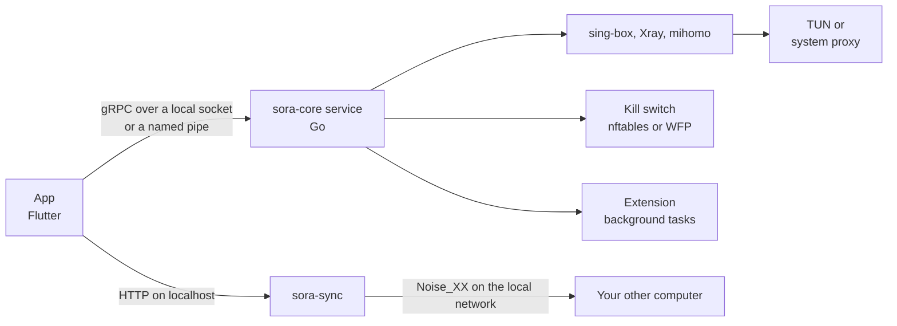

<div align="center">


# Sora

An open source VPN client for Windows and Linux. Paste your subscription link, pick a server, connect.

[Русский](README.md) | **English**

[](https://github.com/levvs-one/sora/releases/latest)
[](https://github.com/levvs-one/sora/releases)
[](https://github.com/levvs-one/sora/actions/workflows/repository.yml)
[](LICENSE)

[Install](#install) | [Features](#features) | [How it works](#how-it-works) | [Docs](docs/) | [Changelog](CHANGELOG.md)

</div>

<p align="center">
  <picture>
    <source media="(prefers-color-scheme: dark)" srcset="docs/images/home-1440x900-dark.png">
    
  </picture>
</p>

## Install

Windows, PowerShell:

```powershell
irm https://github.com/levvs-one/sora/releases/latest/download/install.ps1 | iex
```

Linux:

```sh
curl -fsSL https://github.com/levvs-one/sora/releases/latest/download/install.sh | sh
```

The script picks the packages for your system and architecture and checks their hashes; it also verifies the manifest signature when OpenSSL 3 or minisign is available. What a first install trusts is described in the [installation prerequisites](docs/security/release-signatures.md#initial-installation).

| System | Files | By hand |
| --- | --- | --- |
| Windows 10 1809+ and Windows 11, x64 | `Sora-Setup-<version>-x64.exe` | run the installer |
| Debian, Ubuntu, amd64 and ARM64 | `sora_<version>_<arch>.deb` and `sora-core_<version>_<arch>.deb` | `apt install ./sora*.deb` |
| Fedora, openSUSE, x86_64 and aarch64 | `sora-<version>-1.<arch>.rpm` and `sora-core-<version>-1.<arch>.rpm` | `dnf install ./sora*.rpm` |
| Arch, x86_64 and aarch64 | `sora-<version>-1-<arch>.pkg.tar.zst` and `sora-core-…` | `pacman -U sora*.pkg.tar.zst` |

All files are on the [releases page](https://github.com/levvs-one/sora/releases/latest), details in [docs/install.md](docs/install.md). Older Windows versions use the separate [sora-legacy](https://github.com/levvs-one/sora-legacy) client.

## Features

- **Subscriptions.** Subscription links, including Xray JSON subscriptions. Scheduled refresh, remaining traffic, expiry and provider announcements. Your own edits on top of a subscription (rename, hide a server) survive its refresh.
- **Protocols and engines.** VLESS, VMess, Trojan, Shadowsocks, Hysteria2, TUIC, WireGuard and AmneziaWG, with REALITY and XHTTP transports. Three engines, sing-box, Xray and mihomo, chosen per connection.
- **Server choice.** Automatic choice by latency, measured throughput or both, failover and switching away from a badly degraded server, chains of two or three servers, and servers you add by hand.
- **Traffic protection.** A virtual adapter (TUN) or the system proxy. A kill switch, and an optional strict mode that keeps the block even after the app crashes, until you disconnect on purpose. Rules by site, IP address and app.
- **Checks.** DNS, IPv6 and tunnel leak tests with a suggested fix. A connections screen grouped by app, a log and diagnostics export.
- **Network profiles.** Settings bound to a Wi-Fi network, gateway or provider, applied on request or on their own.
- **Sync.** Subscriptions, rules and settings between your computers on the local network: QR pairing, end-to-end encryption, no accounts and no cloud.
- **Extensions.** A catalog of signed extensions: panels, themes, routing rules and background tasks that may fetch allowlisted addresses through the VPN only. Permissions are confirmed at install. See [docs/extensions.md](docs/extensions.md).
- **zapret on Linux.** DPI bypass without a server, and next to the VPN for direct traffic. It does not hide your IP address or replace a VPN.
- **Everything else.** Tray, start at login, in-app updates with a staged rollout and, on Linux, an automatic rollback when the new version fails to start. 32 interface languages, light and dark themes.

<table>
  <tr>
    <td width="33%">
      <picture>
        <source media="(prefers-color-scheme: dark)" srcset="docs/images/extensions-1000x720-dark.png">
        
      </picture>
    </td>
    <td width="33%">
      <picture>
        <source media="(prefers-color-scheme: dark)" srcset="docs/images/settings-1000x720-dark.png">
        
      </picture>
    </td>
    <td width="33%">
      <picture>
        <source media="(prefers-color-scheme: dark)" srcset="docs/images/notifications-1000x720-dark.png">
        
      </picture>
    </td>
  </tr>
  <tr>
    <td align="center">Extension catalog</td>
    <td align="center">Settings</td>
    <td align="center">Notifications</td>
  </tr>
</table>

## How it works



The app never touches the network stack itself: everything that needs privileges is done by the `sora-core` service. It builds the configuration for the chosen engine, brings the tunnel up, holds the firewall rules and runs extension background tasks in a separate process with memory and CPU limits. Sync lives in its own `sora-sync` process and talks only to paired devices. Details in [docs/architecture.md](docs/architecture.md).

## Security and privacy

- No telemetry. The app itself only contacts GitHub: for update information (can be turned off in settings) and, when you open the extension store, for the catalog and the revocation list. GitHub sees your IP address, as with any website visit.
- Since 1.1.3 every release is signed with the Sora team key (`SHA256SUMS.minisig`). The app and the service check the signature, version, platform, size and hash of an update before installing it, and on Linux before a rollback too. Unsigned 1.1.2 and older are rejected; see the [transition requirements](docs/security/release-signatures.md#signed-release-transition). The Windows installer is not Authenticode-signed yet, so SmartScreen may warn.
- The extension catalog and the revocation list are signed with the Sora team key compiled into the app. Extension packages are signed with their authors' keys, and the key is checked again on every update.

The threat model and the data Sora keeps are described in [docs/security.md](docs/security.md). Report vulnerabilities as described in [SECURITY.md](SECURITY.md).

## Documentation

All guides except the extension developer docs are in Russian.

- Users: [installation](docs/install.md), [usage](docs/usage.md), [FAQ](docs/faq.md), [troubleshooting](docs/troubleshooting.md).
- Providers: [subscription formats](docs/providers.md).
- Developers: [architecture](docs/architecture.md), [building from source](docs/development.md), [extensions](docs/extensions.md).
- [Changelog](CHANGELOG.md) and [plans](PLANS.md).

## Contributing

Bugs and ideas go to [issues](https://github.com/levvs-one/sora/issues). Before a pull request, read [docs/development.md](docs/development.md): it covers the build and the checks CI runs.

## License

[GPL-3.0](LICENSE). [Third-party licenses](THIRD-PARTY-NOTICES.md).
