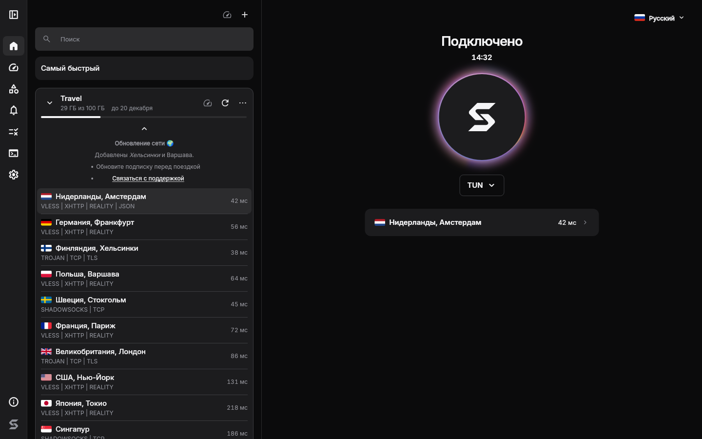

# Sora

[Русский](README.md)

Sora is an open source VPN client for Windows and Linux. Use it with a subscription from your VPN provider: add the link, choose a server and connect.


<details>
<summary>Dark theme</summary>



</details>

## Install

Windows 10 1809+ or Windows 11, x64. In PowerShell:

```powershell
irm https://github.com/levvs-one/sora/releases/latest/download/install.ps1 | iex
```

Linux x64: Debian, Ubuntu, Fedora, openSUSE, Arch. In a terminal:

```sh
curl -fsSL https://github.com/levvs-one/sora/releases/latest/download/install.sh | sh
```

The scripts download the latest release, verify checksums and install the app and its service. Installation requires administrator rights. For manual installation, download the installer or packages from [releases](https://github.com/levvs-one/sora/releases).

## What Sora does

- Imports subscriptions by link, including Xray JSON subscriptions. Updates servers on a schedule and shows traffic usage, expiry dates and announcements when the provider supplies them.
- Picks the server with the lowest latency and supports backup servers when a connection fails.
- Connects apps through a virtual network adapter (TUN) or the system proxy.
- Blocks internet access when the VPN drops if the kill switch is enabled.
- Routes selected sites, IP addresses and apps directly, through the VPN, or blocks them.
- On Linux, bypasses some blocks without a server using zapret. This mode does not hide your IP address or replace a VPN.
- Opens speed test services inside the app, keeps notification history and shows categorized logs with export.
- Runs in the tray, starts at login and installs updates from the app. Includes 31 interface languages, light and dark themes.

The legacy client for older Windows is developed separately in [sora-legacy](https://github.com/levvs-one/sora-legacy).

## Documentation

These guides are in Russian.

- [Installation, updates and removal](docs/install.md)
- [Using Sora](docs/usage.md)
- [Subscription formats and provider guide](docs/providers.md)
- [Troubleshooting](docs/troubleshooting.md)
- [Architecture](docs/architecture.md)
- [Development and building](docs/development.md)
- [Changelog](CHANGELOG.md)
- [Plans](PLANS.md)

## License

[GPL-3.0](LICENSE). [Third-party licenses](THIRD-PARTY-NOTICES.md).
