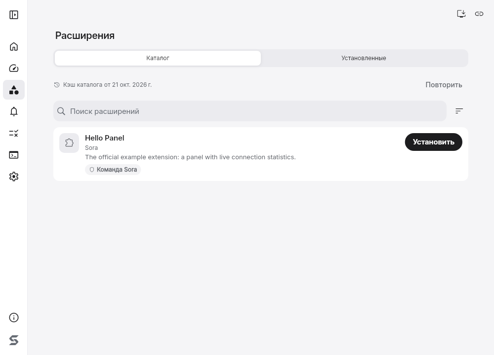
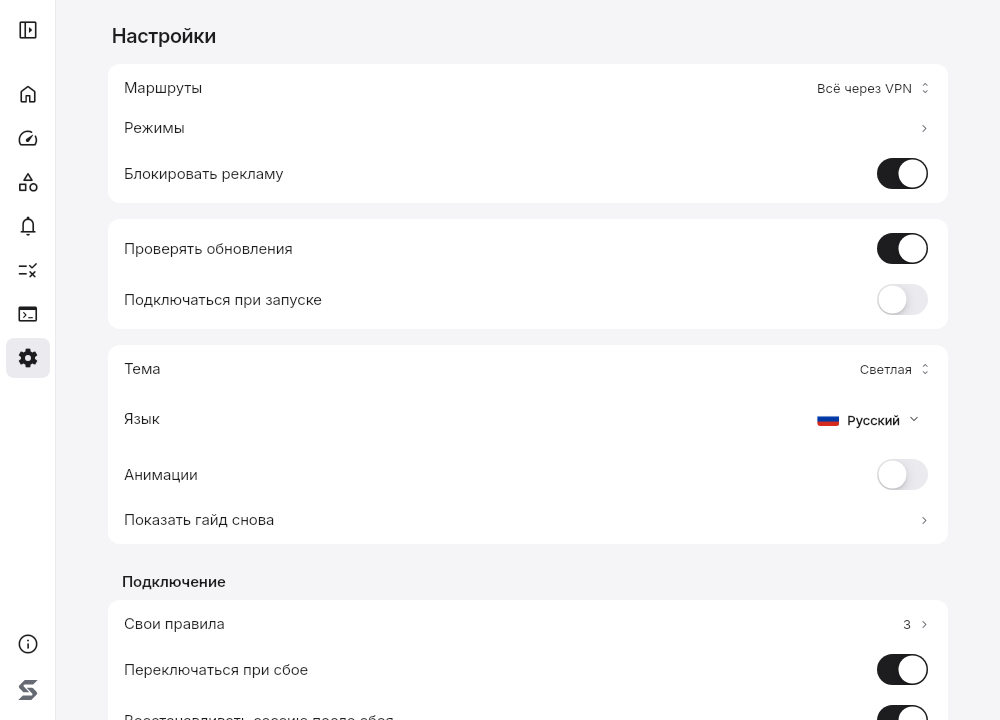
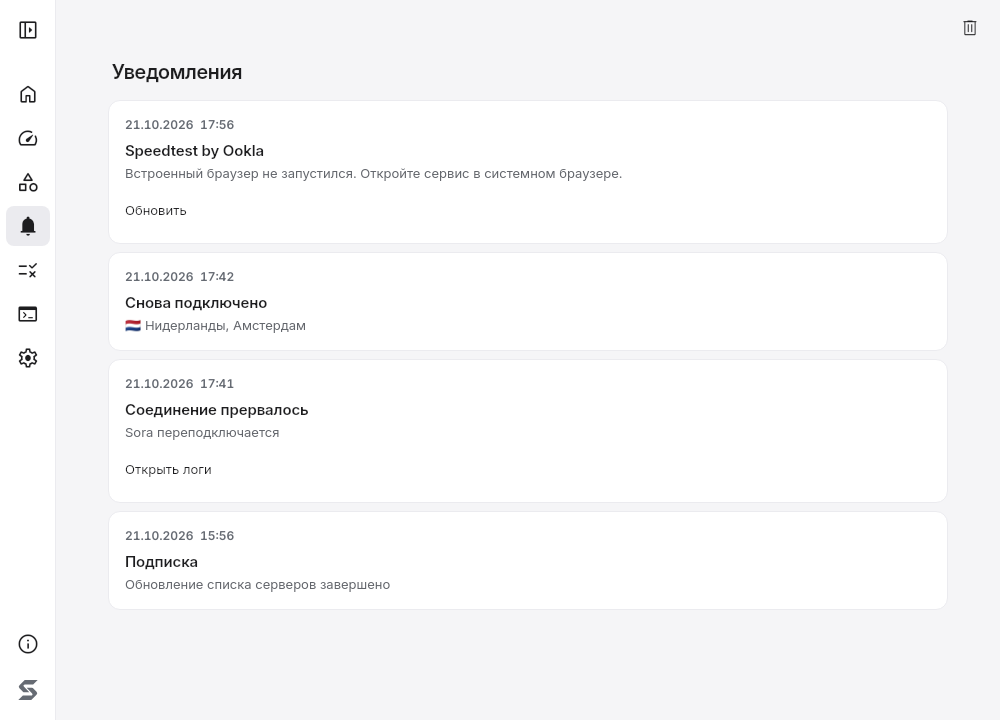
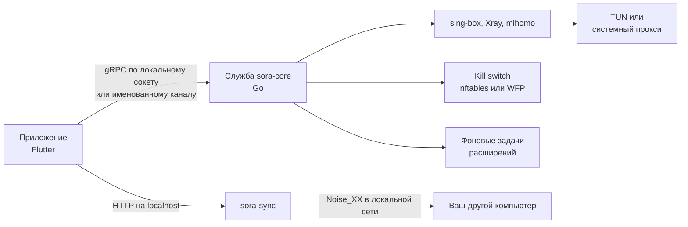

<div align="center">


# Sora

Открытый VPN-клиент для Windows и Linux. Вставьте ссылку подписки, выберите сервер, подключитесь.

**Русский** | [English](README.en.md)

[](https://github.com/levvs-one/sora/releases/latest)
[](https://github.com/levvs-one/sora/releases)
[](https://github.com/levvs-one/sora/actions/workflows/repository.yml)
[](LICENSE)

[Установка](#установка) | [Возможности](#возможности) | [Как это устроено](#как-это-устроено) | [Документация](docs/) | [Изменения](CHANGELOG.md)

</div>

<p align="center">
  <picture>
    <source media="(prefers-color-scheme: dark)" srcset="docs/images/home-1440x900-dark.png">
    
  </picture>
</p>

## Установка

Windows, PowerShell:

```powershell
irm https://github.com/levvs-one/sora/releases/latest/download/install.ps1 | iex
```

Linux:

```sh
curl -fsSL https://github.com/levvs-one/sora/releases/latest/download/install.sh | sh
```

Скрипт выбирает пакеты своей системы и архитектуры и сверяет их хеши, а подпись манифеста проверяет при наличии OpenSSL 3 или minisign. Чему при этом доверяет первая установка, описано в [условиях первого запуска](docs/security/release-signatures.md#initial-installation).

| Система | Файлы | Вручную |
| --- | --- | --- |
| Windows 10 1809+ и Windows 11, x64 | `Sora-Setup-*-x64.exe` | запустить установщик |
| Debian, Ubuntu, amd64 и ARM64 | `sora_*.deb` и `sora-core_*.deb` | `apt install ./sora*.deb` |
| Fedora, openSUSE, x86_64 и aarch64 | `sora-*.rpm` и `sora-core-*.rpm` | `dnf install ./sora*.rpm` |
| Arch, x86_64 и aarch64 | `sora-*.pkg.tar.zst` и `sora-core-*.pkg.tar.zst` | `pacman -U sora*.pkg.tar.zst` |

Звёздочка заменяет версию и архитектуру. Все файлы на [странице релизов](https://github.com/levvs-one/sora/releases/latest), подробности в [docs/install.md](docs/install.md). Для старых версий Windows есть отдельный клиент [sora-legacy](https://github.com/levvs-one/sora-legacy).

## Возможности

- **Подписки.** Ссылка подписки, включая JSON-подписки Xray. Обновление по расписанию, остаток трафика, срок и объявления провайдера. Свои правки поверх подписки (переименовать, скрыть сервер) переживают её обновление.
- **Протоколы и движки.** VLESS, VMess, Trojan, Shadowsocks, Hysteria2, TUIC, WireGuard и AmneziaWG, транспорты REALITY и XHTTP. Три движка: sing-box, Xray и mihomo, движок выбирается под подключение.
- **Выбор сервера.** Автовыбор по задержке, переключение при сбое и при сильной деградации, цепочки из двух или трёх серверов, свои серверы, добавленные вручную.
- **Защита трафика.** Виртуальный адаптер (TUN) или системный прокси. Kill switch, а по желанию строгий режим: он держит блокировку и после сбоя приложения, пока вы явно не отключитесь. Правила по сайтам, IP-адресам и программам.
- **Проверки.** Тест утечек DNS, IPv6 и трафика мимо туннеля с подсказкой, как исправить. Экран соединений с группировкой по программам, журнал и экспорт диагностики.
- **Сетевые профили.** Настройки привязываются к Wi-Fi, шлюзу или провайдеру и применяются по запросу или сами, если профили включены.
- **Синхронизация.** Подписки, правила и настройки между вашими компьютерами в локальной сети: сопряжение по QR-коду, сквозное шифрование, без аккаунтов и облака.
- **Расширения.** Каталог подписанных расширений: панели, темы, правила маршрутизации и фоновые задачи с запросами по белому списку адресов только через VPN. Разрешения подтверждаются при установке. Подробнее в [docs/extensions.md](docs/extensions.md).
- **zapret на Linux.** Обход DPI без сервера, а также вместе с VPN для прямого трафика. Он не скрывает IP-адрес и не заменяет VPN.
- **Остальное.** Трей, запуск при входе, обновление из приложения с поэтапной раскаткой и автоматическим откатом на Linux, если новая версия не запустилась. 32 языка интерфейса, светлая и тёмная темы.

<table>
  <tr>
    <td width="33%">
      <picture>
        <source media="(prefers-color-scheme: dark)" srcset="docs/images/extensions-1000x720-dark.png">
        
      </picture>
    </td>
    <td width="33%">
      <picture>
        <source media="(prefers-color-scheme: dark)" srcset="docs/images/settings-1000x720-dark.png">
        
      </picture>
    </td>
    <td width="33%">
      <picture>
        <source media="(prefers-color-scheme: dark)" srcset="docs/images/notifications-1000x720-dark.png">
        
      </picture>
    </td>
  </tr>
  <tr>
    <td align="center">Каталог расширений</td>
    <td align="center">Настройки</td>
    <td align="center">Уведомления</td>
  </tr>
</table>

## Как это устроено



Приложение не работает с сетью напрямую: всё, что требует прав, делает служба `sora-core`. Она собирает конфигурацию для выбранного движка, поднимает туннель, держит правила межсетевого экрана и запускает фоновые задачи расширений в отдельном процессе с ограничением памяти и процессорного времени. Синхронизация живёт в своём процессе `sora-sync` и общается только с сопряжёнными устройствами. Подробности в [docs/architecture.md](docs/architecture.md).

## Безопасность и приватность

- Телеметрии нет. Само приложение обращается только к GitHub: за сведениями об обновлениях (отключается в настройках) и, когда вы открываете магазин расширений, за каталогом и списком отзыва. GitHub при этом видит ваш IP-адрес, как при обычном посещении сайта.
- Начиная с 1.1.3 каждый релиз подписан ключом команды Sora (`SHA256SUMS.minisig`). Приложение и служба проверяют подпись, версию, платформу, размер и хеш обновления до установки, а на Linux ещё и до отката. Неподписанные 1.1.2 и старше не принимаются; см. [условия перехода](docs/security/release-signatures.md#signed-release-transition). Установщик Windows пока не подписан Authenticode, поэтому SmartScreen может предупреждать.
- Каталог расширений и список отзыва подписаны ключом команды Sora, вшитым в приложение. Пакеты расширений подписаны ключами авторов, ключ сверяется при каждом обновлении.

Модель угроз и данные, которые хранит Sora, описаны в [docs/security.md](docs/security.md). Об уязвимостях пишите по [SECURITY.md](SECURITY.md).

## Документация

- Пользователям: [установка](docs/install.md), [как пользоваться](docs/usage.md), [частые вопросы](docs/faq.md), [если что-то не работает](docs/troubleshooting.md).
- Провайдерам: [форматы подписок](docs/providers.md).
- Разработчикам: [архитектура](docs/architecture.md), [сборка из исходников](docs/development.md), [расширения](docs/extensions.md).
- [История изменений](CHANGELOG.md) и [планы](PLANS.md).

## Участие

Ошибки и предложения в [issues](https://github.com/levvs-one/sora/issues). Перед пулл-реквестом прочитайте [docs/development.md](docs/development.md): там описаны сборка и проверки, которые запускает CI.

## Лицензия

[GPL-3.0](LICENSE). [Лицензии сторонних компонентов](THIRD-PARTY-NOTICES.md).
