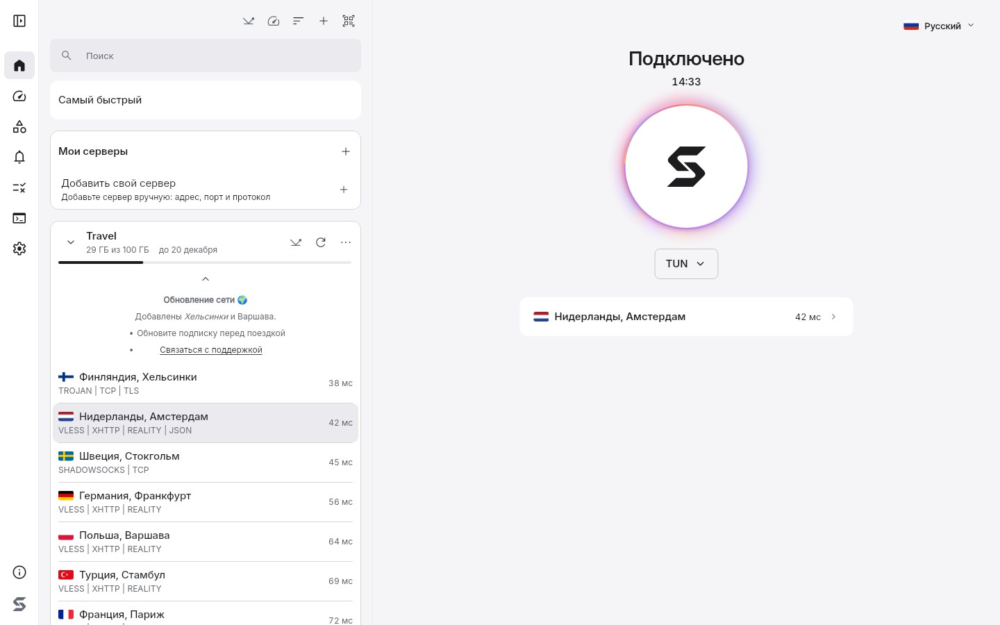

<p align="center">
  
</p>
<h1 align="center">Sora</h1>

[English](README.en.md)

[](https://github.com/levvs-one/sora/releases)
[](https://github.com/levvs-one/sora/releases)
[](LICENSE)

Открытый VPN-клиент для Windows и Linux. Работает с подпиской вашего VPN-провайдера: вставьте ссылку, выберите сервер, подключитесь.

<picture>
  <source media="(prefers-color-scheme: dark)" srcset="docs/images/home-1440x900-dark.png">
  
</picture>

## Установка

Windows 10 1809+ или Windows 11, x64. В PowerShell:

```powershell
irm https://github.com/levvs-one/sora/releases/latest/download/install.ps1 | iex
```

Linux x64: Debian, Ubuntu, Fedora, openSUSE, Arch. В терминале:

```sh
curl -fsSL https://github.com/levvs-one/sora/releases/latest/download/install.sh | sh
```

Скрипты скачивают последний релиз, проверяют контрольные суммы и устанавливают приложение со службой. Нужны права администратора. Для ручной установки скачайте установщик или пакеты со страницы [релизов](https://github.com/levvs-one/sora/releases).

Для старых версий Windows есть отдельный клиент [sora-legacy](https://github.com/levvs-one/sora-legacy).

## Быстрый старт

1. Вставьте ссылку подписки.
2. Выберите сервер.
3. Нажмите «Подключить».

## Возможности

- Подписки по ссылке, включая JSON-подписки Xray: обновление по расписанию, трафик, срок и объявления провайдера, правки поверх подписки, которые переживают её обновление.
- Протоколы VLESS, VMess, Trojan, Shadowsocks, Hysteria2, TUIC, WireGuard и AmneziaWG, транспорты REALITY и XHTTP. Три движка на выбор: sing-box, Xray, mihomo.
- Автовыбор сервера по задержке и измеренной скорости, запасные серверы при сбое, цепочки из двух или трёх серверов, свои серверы, добавленные вручную.
- Виртуальный адаптер (TUN) или системный прокси, kill switch, правила по сайтам, IP-адресам и программам.
- Сетевые профили: настройки привязываются к Wi-Fi, шлюзу или провайдеру и применяются по запросу или автоматически, если вы это включили.
- Проверка утечек DNS, IPv6 и туннеля, экран соединений с группировкой по программам, диагностика с экспортом.
- QR-код подписки и чтение QR с картинки. Синхронизация подписок, правил и настроек между вашими компьютерами в локальной сети без облака, канал шифруется.
- Расширения: каталог подписанных расширений, установка из файла, разрешения подтверждаются при установке. Подробнее в [docs/extensions.md](docs/extensions.md).
- На Linux режим zapret без сервера и zapret вместе с VPN для прямого трафика. Он не скрывает IP-адрес и не заменяет VPN.
- Работает из трея, запускается при входе в систему и обновляется из приложения. 31 вариант языка интерфейса, светлая и тёмная темы.

## Безопасность

- Релизы сопровождаются файлом `SHA256SUMS`. Установочные скрипты и обновление из приложения сверяют по нему контрольные суммы и ничего не ставят при расхождении. Сам `SHA256SUMS` пока не подписан, его подлинность держится на HTTPS-соединении с GitHub.
- Каталог расширений и список отозванных расширений подписаны ключом команды Sora, вшитым в приложение. Пакеты расширений подписаны ключами авторов.
- Телеметрии нет: Sora не отправляет аналитику и статистику разработчикам. Само приложение обращается только к GitHub: за сведениями об обновлениях (отключается в настройках) и, когда вы открываете магазин расширений, за каталогом и списком отзыва. GitHub при этом видит ваш IP-адрес, как при обычном посещении сайта.

Подробности в [docs/security.md](docs/security.md).

## Документация

- Пользователям: [установка](docs/install.md), [как пользоваться](docs/usage.md), [частые вопросы](docs/faq.md), [если что-то не работает](docs/troubleshooting.md).
- Провайдерам: [форматы подписок](docs/providers.md).
- Разработчикам: [архитектура](docs/architecture.md), [сборка из исходников](docs/development.md), [расширения](docs/extensions.md).
- Безопасность: [модель приватности и данные](docs/security.md).
- [История изменений](CHANGELOG.md) и [планы](PLANS.md).

Полный указатель документации в [docs/](docs/).

## Лицензия

[GPL-3.0](LICENSE). [Лицензии сторонних компонентов](THIRD-PARTY-NOTICES.md).
